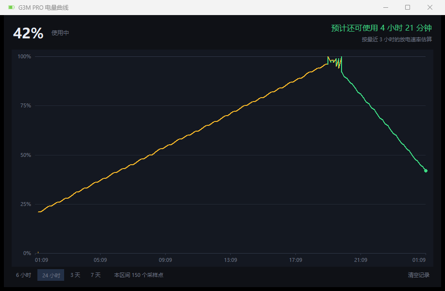

# G3M PRO 电量托盘 / HECATE G3M Battery

> 不打开 HECATE Connect 控制软件，也能随时看到 **HECATE G3M PRO** 无线鼠标的电量。
>
> A tiny, dependency-free Windows tray app that reads the battery level of the
> **HECATE G3M PRO** wireless mouse over its 2.4G dongle's vendor HID channel —
> without the official HECATE Connect software.

[](#)
[](#)
[](#)
[](#)


---

## 特性

- **零依赖**：只用 Python 标准库（`ctypes` + `tkinter`），不需要 `pip install` 任何东西
- **不需要管理员权限**，**不需要 HECATE Connect 在运行**
- **托盘图标**：电池形状，填充比例与颜色随电量变化；鼠标悬停显示百分比
- **电量曲线**：右键托盘 →「电量曲线…」，查看 6 小时 ~ 7 天的历史曲线，并**预估剩余使用时长**
- **桌面悬浮窗**：置顶、可拖动、记住位置，每 30 秒自动刷新
- **低电量变色**：>50% 绿 / 21–50% 琥珀 / ≤20% 红（数字、进度条、托盘图标同步）
- **充电状态**：显示 `使用中` / `充电中` / `已充满`
- 命令行模式：`python g3m_battery.py` 直接打印，支持 `--json` 便于脚本调用




---

## 电量曲线与剩余时长

右键托盘图标 → **「电量曲线…」**。


- **时间范围**：6 小时 / 24 小时 / 3 天 / 7 天（选择会记住）
- **曲线着色**：绿色 = 放电，琥珀色 = 充电
- **悬停**：鼠标移到曲线上显示该时刻的时间、电量与状态
- **剩余时长**：基于**最近 3 小时**的连续放电数据做最小二乘线性回归，用当前电量 ÷ 放电速率

估算刻意做了保守处理，以下情况会显示"数据不足"而不是瞎猜：

- 连续放电观察不足 10 分钟，或采样点少于 4 个
- 累计下降不足 2%（电量在 1% 精度上还没脱离噪声）
- 中间有超过 15 分钟的断档（休眠/关机）→ 只取最后一段连续区间
- 充电中 / 已充满 → 不估算
- 算出来超过 7 天（明显异常）→ 判为数据不足

**数据存在本机** `history.jsonl`（与程序同目录，已 gitignore），不上传、不外发：

- 每 30 秒记一条，超过 14 天自动裁剪
- 超过 2 天的老数据按 10 分钟抽稀，文件不会无限增长
- 窗口右下角「清空记录」可一键删除

也可以直接带参数启动到曲线窗口：

```powershell
pythonw battery_tray.pyw --curve
```

---

## 快速开始

**要求**：Windows 10/11 + Python 3.8 以上（安装时勾选 "Add to PATH"）。

```powershell
git clone https://github.com/Nefeli0721/g3m-battery.git
cd g3m-battery
```

然后二选一：

| 方式 | 操作 |
|---|---|
| 托盘 + 悬浮窗 | 双击 `start_tray.vbs`（无控制台窗口） |
| 命令行 | 双击 `battery.bat`，或 `python g3m_battery.py` |

开机自启（可选）：

```powershell
powershell -ExecutionPolicy Bypass -File .\install-autostart.ps1   # 安装
powershell -ExecutionPolicy Bypass -File .\remove-autostart.ps1    # 移除
```

### 命令行用法

```powershell
python g3m_battery.py                 # 读一次
python g3m_battery.py --json          # JSON 输出，便于脚本调用
python g3m_battery.py --raw           # 附带原始帧
python g3m_battery.py --frame         # 只打印请求帧与校验和
python g3m_battery.py --list          # 列出该设备的全部 HID 接口
python g3m_battery.py -n 10 -i 5      # 每 5 秒读一次，共 10 次
```

输出示例：

```json
{"device":"G3M PRO","percent":90,"charge_state":1,"charge_label":"充电中","payload":"5a0100000000"}
```

退出码：`0` 成功、`2` 未连接、`3` 读取失败，方便写成脚本。

---

## 工作原理

设备是 HECATE **G3M PRO** 的 2.4G 接收器（Telink 芯片，`VID 0x320F / PID 0x706E`）。
它暴露 5 个 HID 集合，其中 **`MI_01&COL04`**（UsagePage `0xFF1C` / Usage `0x92`）
是厂商私有通道：**64 字节 output report → 64 字节 input report**。

### 请求帧（64 字节）

```
偏移  值        含义
 0    04        报告 ID
 1    sum&0xFF  校验和低字节
 2    sum>>8    校验和高字节     (sum = Σ frame[3..63]，设备其实不校验)
 3    1A        命令码 CMD_STATUS（读状态块）
 4    06        请求返回字节数 = 6
 5    00        offset 低
 6    00        offset 高
 7    00
 8..63 00       填充
```

即：`04 20 00 1A 06 00 00 00` + 56 个 `00`

### 响应帧

```
偏移  值          含义
 0    04          报告 ID
 1..2              原样回显校验和
 3    1A          必须回显命令码，否则该帧无效
 7    00          成功；0xFF = 错误 -102，0xFE = 错误 -103
 8    5A          电量百分比 0..100（整数直出，无缩放）
 9    01          充电状态：0=使用中  1=充电中  2=已充满
 10..13  …         其余状态块字节（未使用，语义未知）
```

### 电量是怎么算出来的

检测发生在**鼠标固件**里：ADC 采电池电压 → 固件换算成 0..100 → 经上面这条协议下发。
PC 端拿不到原始电压/ADC（`0x1A`、`0x03`、`0x07` 三个只读命令都探测过，均无 mV 字段），
所以工具只能**忠实显示固件给的数字**，无法自行校准。

**关于「已充满」**：协议与官方 UI 都支持 `state=2`（对应 `powered.png`），但 G3M PRO
这台设备**从不报 2** —— 100% 插线状态下连续采样 111 次/6 分钟恒为 `1`；同时打开官方
HECATE Connect，它显示的也是"闪电"图标而非"已充满"。因此工具把 **100% + 插线** 展示为
「已充满」，原始 `charge_state` 仍如实保留在 `--json` 里。

### 怎么逆出来的

1. **动态被动观测**：HID 输入报告会广播给所有读句柄，直接读到 App 与设备的真实往来。
   官方界面显示 90% 时设备回 `04 20 00 1A 06 00 00 00 5A`（`0x5A` = 90），完全对应。
2. **静态反汇编**：对 `HECATE_Connect_installer.exe`（32 位 x86 MSVC，未加壳）做全量
   capstone 反汇编 + 交叉引用，定位到命令构造函数 `0x47e6c0`、电量刷新 `0x48aa00`、
   UI 解析 `0x4353c0`，与动态结论互证。
3. **独立验证**：终止官方进程后工具仍稳定读数；插拔充电线时 `resp[9]` 在 `0/1` 间切换。

完整静态分析报告见 [`docs/findings-static.md`](docs/findings-static.md)。

> 一个有意思的坑：最初误以为 `0x20` 是命令码，其实它是**校验和**——
> 只是 `0x1A + 0x06 = 0x20` 恰好凑对了，纯属运气，后来被静态分析纠正。

---

## 仓库结构

```
.
├── g3m_battery.py          核心：设备枚举 + 协议帧 + 解析（也可当 CLI）
├── battery_tray.pyw        托盘图标 + 桌面悬浮窗
├── battery_curve.py        电量曲线窗口（Canvas 绘图 + 悬停提示）
├── battery_history.py      历史记录存储 + 剩余时长估算
├── make_icons.py           生成托盘电池图标（纯 Python 写 .ico）
├── watch_charge.py         观察充电状态位随时间变化（排查「已充满」用）
├── probe_info.py           只读探测：确认固件是否暴露原始电压
├── start_tray.vbs          双击启动（无控制台）
├── battery.bat             双击查一次电量
├── install-autostart.ps1   开机自启安装
├── remove-autostart.ps1    开机自启移除
├── release.py              一键发布（版本号 + CHANGELOG + tag + push）
├── CHANGELOG.md            版本变更记录
├── CONTRIBUTING.md         分支策略与开发流程
├── tests/                  单元测试（stdlib unittest）
├── docs/
│   └── findings-static.md   静态逆向完整报告
├── recon/                   逆向过程用的探针脚本（存档）
└── screenshots/
```

`icons/` 与 `settings.json` 是运行时生成的，已在 `.gitignore` 中忽略。

---

## 分支策略

| 分支 | 定位 | 允许的变更 | 版本号 |
|---|---|---|---|
| **`main`** | **轻量化稳定版** | 只收 **bug 修复** 与 **设备适配** | 只发 patch `1.0.x` |
| **`dev`** | **功能分支** | 所有**新功能**、重构、体验改进 | minor / major `1.1.0`、`2.0.0` |

`main` 的设计目标是**保持轻量**：零依赖、代码量不膨胀、只做"能稳定读到电量"这一件事。
任何功能加法（通知、多设备管理、面板、插件…）一律进 `dev`，不往 `main` 堆。

详细流程见 [CONTRIBUTING.md](CONTRIBUTING.md)。

## 版本管理与发布

本项目遵循 [语义化版本](https://semver.org/lang/zh-CN/)，版本历史见
[CHANGELOG.md](CHANGELOG.md) 和 [Releases](https://github.com/Nefeli0721/g3m-battery/releases)。

- **唯一版本号来源**：`g3m_battery.py` 里的 `__version__`
  （`python g3m_battery.py --version` 可查看，托盘右键菜单也会显示）
- 规则：**修 bug / 加设备 = patch**、**新功能 = minor**、**破坏兼容 = major**
- 每次发布都走完整流程：改版本号 → 更新 CHANGELOG → commit → 打 `vX.Y.Z` tag →
  push → 创建 GitHub Release

发布用一条命令（先把改动提交完，保持工作区干净）：

```powershell
# main：修 bug / 加设备（只允许 patch）
python release.py 1.0.1 "修复休眠后无法恢复" --kind bugfix
python release.py 1.0.2 "支持 G5M Pro" --kind device

# dev：新功能（minor / major）
python release.py 1.1.0 "新增低电量通知" --kind feature

python release.py 1.1.0 "..." --dry-run   # 只看计划，不写不改
```

`release.py` 会强制拦截：在 `main` 上发新功能、在 `main` 上发 minor/major、
工作区不干净、tag 已存在、不在 `main`/`dev` 分支、版本号没递增。

---

## 兼容性与限制

- 目前**只针对 `VID 0x320F / PID 0x706E`（G3M PRO）**。同品牌其它型号若也走
  `MI_01&COL04` + `FF1C/92`，把 `g3m_battery.py` 顶部的 `TARGET_VID` / `TARGET_PID`
  改掉即可，大概率可直接用。
- 鼠标休眠/关机时无法回包，界面显示"未连接"。
- 接收器换 USB 口后仍可用（每次都会重新枚举，不写死路径）。
- 只覆盖电量与充电状态；DPI、灯光、宏走另外的命令（见 `docs/findings-static.md`），未实现。

---

## 免责声明

本项目仅用于**个人设备互操作性研究**：让你在自己的硬件上读到电量，不必为此常驻官方软件。
"HECATE / G3M PRO" 等商标归其各自所有者，本项目与厂商无关联、未经其授权。
协议信息来自对**自己购买的设备**及其软件的观察与分析。使用风险自负。

## License

[MIT](LICENSE)
